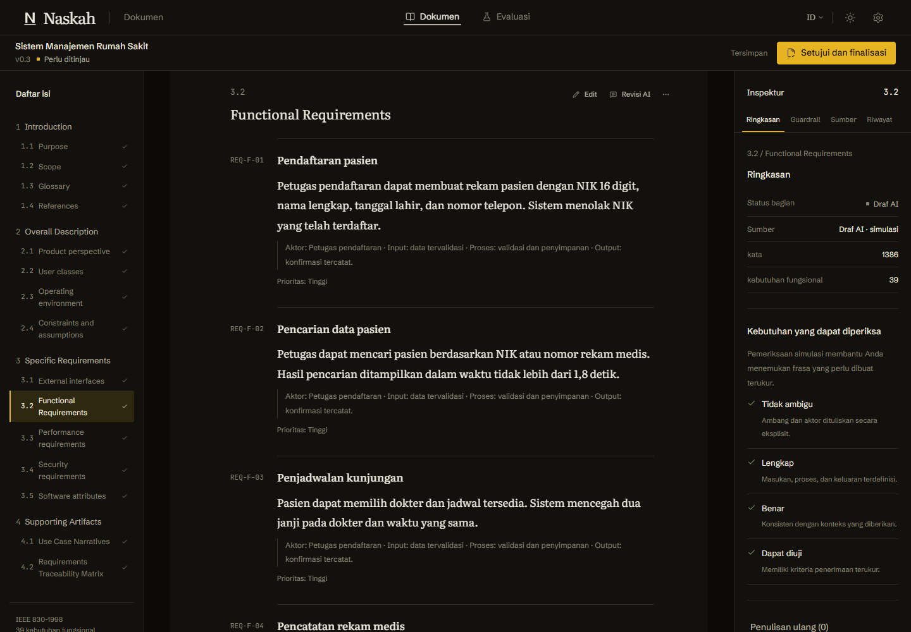
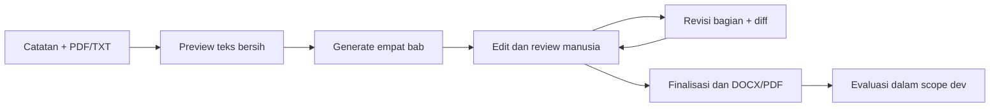

<div align="center">

# SRequeS

**From working notes to requirements you can review.**

Penyusun draf SRS dengan struktur IEEE 830-1998, review manusia, dan evaluasi penelitian.


</div>



Checkpoint **B10 — 11 November 2026**: backend lokal terhubung ke n8n dan Supabase,
parser PDF/TXT, compiler DOCX/PDF, serta evaluator Python. Generate SRS dan Revise
Section telah diuji menyeluruh dengan **provider mock lokal**. Dokumentasi serah
terima selesai; keberhasilan API asli, corpus penelitian, dan studi responden
belum diklaim. Aplikasi memakai Bahasa Indonesia/English serta tema terang/gelap.

## Jalankan di Windows

Untuk membuka webapp dan menghitung BERTScore lokal, jalankan dari folder proyek:

```powershell
git pull
npx.cmd --yes pnpm@11.25.0 dev
```

Pasang Node.js 24+ dan Docker Desktop dengan Linux containers terlebih dahulu.
Startup memasang dependency sesuai lockfile, menyalakan Docker Desktop bila perlu,
menyiapkan image evaluator, dan menunggu BERTScore siap sebelum membuka webapp di
[127.0.0.1:3000](http://127.0.0.1:3000). Build pertama membutuhkan internet untuk
mengunduh image dan model; berikutnya image lokal digunakan kembali. Konfigurasi
evaluator dibuat otomatis di `.env.local` tanpa mengganti nilai yang sudah ada.
Clone baru memakai mode simulasi untuk fitur aplikasi, dengan BERTScore tetap
dihitung oleh evaluator Docker lokal.

Untuk laptop yang sudah dikonfigurasi ini, buka PowerShell:

```powershell
Set-Location -LiteralPath 'C:\Users\MSI1\OneDrive\文档\WebApp Skripsi'
powershell -NoProfile -ExecutionPolicy Bypass -File .\scripts\start-local.ps1 -Mode live
```

Buka **[Naskah](http://127.0.0.1:3000)**. Biarkan terminal terbuka; Ctrl+C
menghentikan webapp. Script mencoba menyalakan Docker Desktop, n8n existing,
mock provider, Supabase, compiler, dan evaluator tanpa reset volume. Jika port
3000 sudah dipakai, server lama dipertahankan; hentikan dahulu untuk ganti mode.

`live` berarti memakai backend sungguhan di laptop. **LLM dan embeddings tetap
mock** pada port 4010; mode ini tidak mengaktifkan API berbayar dengan sendirinya.
`pnpm dev` dan `pnpm start` otomatis menyiapkan evaluator BERTScore lokal.
Ctrl+C menghentikan webapp; container evaluator tetap tersedia untuk pemakaian berikutnya.
Panduan prasyarat, berhenti/restart, alternatif
pnpm Windows, dan penyiapan mesin baru: [Panduan Windows](docs/local-laptop-setup.md).

| Layanan | Alamat lokal |
| --- | --- |
| Webapp / Settings / Evaluasi | [3000](http://127.0.0.1:3000) / [Settings](http://127.0.0.1:3000/settings) / [Evaluasi](http://127.0.0.1:3000/evaluation) |
| n8n | [5678](http://127.0.0.1:5678) |
| Supabase API / PostgreSQL / Studio | 54321 / 54322 / [54323](http://127.0.0.1:54323) |
| Mock provider / Compiler / Evaluator | 4010 / 8000 / 8010 |

## Alur yang tersedia



| Fitur | Backend lokal (`live`) | Browser saja (`mock`) |
| --- | --- | --- |
| Proyek, edit, persetujuan, versi | Supabase, pemeriksaan owner/versi/lock | IndexedDB per origin/browser |
| Generate / Revise | n8n, retrieval, checkpoint, SSE, proposal accept/reject | Fixture deterministik, tanpa panggilan LLM |
| PDF/TXT | Parser server dan shared cleaning | Parser browser |
| Word/PDF | Pandoc + LibreOffice, Storage privat, download terautentikasi | DOCX browser dan print-to-PDF |
| Settings | Key terenkripsi, sinkron credential, smoke melalui n8n | Key di memori tab, tes simulasi |
| Evaluasi | Consent, blind review, SUS, BERTScore/statistik Python, ekspor pseudonim | Form penelitian di browser dan perbandingan BERTScore melalui Docker lokal |

Mock provider menghasilkan jawaban deterministik. Jalur integrasi yang lulus
tidak membuktikan kualitas generasi AI nyata. Review hasil sebelum digunakan.

## Sebelum memakai API asli

1. **n8n REST key:** sudah tersimpan dan diuji di laptop ini; perbarui jika
   kedaluwarsa/ditolak. Token OAuth MCP berbeda dari REST key backend.
2. **Key DeepSeek dan embeddings:** masukkan sendiri melalui Settings; jangan
   tempel ke chat atau Git. Tes koneksi provider asli belum dilakukan.
3. **Corpus nyata:** tinjau izin sumber, selesaikan extraction/chunking, dan
   lakukan ingestion dengan model/dimensi yang benar pada lingkungan terpisah.
   Sebanyak 150 vector `dev_seed` saat ini adalah sintetis.

Ikuti [checklist API asli](docs/real-api-checklist.md) untuk urutan dan hasil yang
diharapkan. Enrollment run penelitian belum tersedia di UI; memakai key asli
tidak otomatis menjadikan data layak untuk BAB IV.

## Verifikasi dan pengembangan

Jalankan dari root, memakai Node.js 24+ yang mendukung `process.loadEnvFile` dan
pnpm **11.25.0**. Laptop ini juga telah diuji dengan runtime Node 24.22.1.
Docker Desktop memakai Linux containers. Untuk memasang dependency:

```powershell
pnpm.cmd install --frozen-lockfile
node scripts/doctor.mjs
```

Doctor memeriksa readiness backend, bukan kualitas provider/corpus. Compiler dan
evaluator mempunyai health terpisah; detail ada di runbook.

| Perintah | Kegunaan |
| --- | --- |
| `pnpm typecheck`, `pnpm lint`, `pnpm test` | TypeScript, batas modul, unit/contract |
| `pnpm test:b9` | Acceptance lengkap; webapp live + kedua provider mock wajib siap |
| `pnpm test:e2e` | Playwright; pilih suite/mode seperti runbook |
| `pnpm test:python` | Golden dan numerik Python |
| `pnpm n8n:build`, `pnpm n8n:deploy` | Build dan pasang ulang workflow milik Naskah |
| `pnpm local:compiler`, `pnpm local:evaluation` | Siapkan layanan lokal terkait |
| `pnpm evaluation …` | SUS, ahli, BERTScore, statistik dan ekspor |
| `pnpm scan:secrets` | Scan repo/artifacts/public bundle tanpa mencetak key |
| `pnpm build`, `pnpm start` | Build dan serve webapp; hentikan dev dahulu |

Jangan menjalankan test yang mengubah Settings/mock controller secara bersamaan.
Build dan dev tidak boleh memakai `.next` yang sama secara bersamaan pada Windows.
Jangan menjalankan `local:setup-mock` untuk menimpa konfigurasi provider asli.

## Arsitektur dan penyimpanan

UI menggunakan typed ports; registry memilih adapter `mock` atau `http`. Next.js
menjadi gateway local-owner. Hanya server yang memegang service-role/key; workflow
portable tidak memuat credential ID/nilai laptop. Detail:
[arsitektur](docs/architecture.md), [kontrak](docs/contracts.md), dan
[kontrak Markdown](docs/markdown-contract.md).

| Direktori | Isi |
| --- | --- |
| `apps/web` | Next.js UI, HTTP adapters, API dan backend lokal |
| `packages/contracts`, `packages/core` | Zod, Markdown, template, fungsi domain murni |
| `n8n` | Builder, prompt dan workflow portable |
| `supabase` | Migration bertimestamp dan seed konfigurasi |
| `ingestion` | Fetch/split/chunk/embed/load/verify beserta manifest |
| `compiler-service`, `evaluation-scripts` | Layanan dokumen dan analisis Python |
| `scripts`, `tests` | Operasi lokal dan bukti pengujian |
| `docs` | Panduan, kontrak, traceability dan laporan per fase |
| `infra` | Scaffold lama; bukan Compose privat laptop yang sedang dipakai |

Jangan menimpa `apps/web/.env.local` yang sudah ada dengan `.env.example`.
`APP_ENCRYPTION_KEY`, owner ID, n8n key/volume, database dan Storage harus masuk
rencana backup. `.gitignore` mencegah commit tidak berarti data tersebut tidak
disinkronkan OneDrive. Backup privat ditempatkan di luar repo/sinkronisasi.

## Dokumentasi

| Kebutuhan | Dokumen utama |
| --- | --- |
| Menjalankan, menghentikan dan memeriksa Windows | [Panduan Windows](docs/local-laptop-setup.md) |
| Backup, recovery, rotasi key, provider/template/model baru | [Runbook](docs/runbook.md) |
| Langkah pengguna sebelum API nyata | [Checklist API asli](docs/real-api-checklist.md) |
| Sumber tabel/gambar BAB IV dan reproduksi evaluasi | [Panduan data skripsi](docs/thesis-data-guide.md) |
| Pemetaan semua FR → route/backend/test | [Traceability](docs/traceability.md) |
| Hasil, deviasi dan batas serah terima | [Laporan B10](docs/B10-handoff.md) |
| Bukti acceptance lokal | [B9](docs/B9-end-to-end.md), [B8](docs/B8-evaluation.md), [B7](docs/B7-documents.md), [B6](docs/B6-local-ui.md), [B5](docs/B5-workflows.md) |
| Riwayat implementasi | [Laporan backend](docs/backend-phase-reports.md), [roadmap](docs/backend-roadmap.md), [Phase 1 historis](docs/phase-report.md) |

Proyek ini masih aplikasi satu pemilik di laptop lokal, bukan deployment publik
multiuser. Hasil acceptance sintetis, screenshot dan contoh evaluasi bukan hasil
penelitian responden nyata. Git lokal dan layanan tetap milik pengguna; tidak
ada publish/push otomatis dalam serah terima B10.
