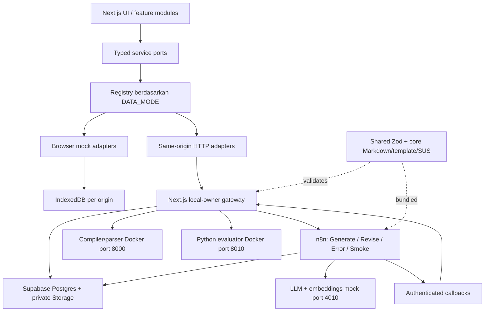

# Arsitektur saat serah terima B10

11 November 2026. Dua mode adapter tetap tersedia; provider mock berbeda dari
mode browser mock. Default operasional laptop adalah **live backend + mock AI**.

Routes merender feature entry point; UI mengakses `useServices`. Hanya registry
memilih mock/http. Entities/core murni tidak mengimpor React, Next atau transport;
ESLint menjaga batas feature ke adapter. Shared schemas menjadi kontrak UI,
gateway, callback dan bundle n8n. PDF.js/editor/diff/docx dimuat sesuai kebutuhan;
font aplikasi self-hosted. Lihat [kontrak](contracts.md) untuk boundary payload.

## Sumber data dan konsistensi

| Data | Mode mock browser | Mode live backend |
| --- | --- | --- |
| Proyek/naskah/version/proposal | Versioned IndexedDB, serialized copy-on-write | Postgres, owner-scoped transaction, optimistic version/lock |
| Settings provider | Config IndexedDB, key hanya memori tab | `integration_secrets` AES-256-GCM, credential n8n |
| Preferences/intake | Browser preferences/sessionStorage | Preferences/session draft tetap browser; dokumen tersimpan di server |
| Artefak ekspor | DOCX browser/print PDF | Compiler bounded, cache metadata DB dan private Storage |
| Evaluasi | Fixture dan scoring browser | Snapshot/participant/review/SUS/report scoped di Postgres; Python menghitung |

IndexedDB bukan sumber data dokumen live. Tidak ada migrasi otomatis antara
browser mock dan server live. Origin/browser lain memiliki storage/cookie sendiri.
Riwayat immutable; restore membuat versi baru. Live section write memerlukan
If-Match, owner dan lock; accept revision mengulang pemeriksaan versi/ID.

## Orkestrasi

Generate mengambil context/template/provider config server-side, retrieval
train-only, drafting empat bab, guardrail, assembly dan callback. Workflow
portable berisi graph/prompt/bundle, bukan nilai key/credential ID laptop. n8n
mengakses host melalui `host.docker.internal`; browser/gateway memakai loopback.
Workflow aktif: Generate SRS, Revise Section, Error Handler dan empat smoke
(DeepSeek, embeddings, Supabase, Markdown).

Checkpoint/event tersimpan sebelum progress direplay lewat SSE. Cursor monotonic
memungkinkan reconnect; resume melewati bab selesai dan menjaga edit manusia.
Callback bearer/freshness/identity serta deduplikasi melindungi terminal write.
Watchdog/cancel mengakhiri job secara eksplisit. Revision menghasilkan proposal
pending; naskah berubah hanya setelah accept dengan lock/version yang sah.
Core Markdown membedakan lossless parse dari canonical render.

## Batas proses dan secret

Local-owner cookie bukan login multiuser. Server-only env tidak memakai prefix
NEXT_PUBLIC untuk key. Supabase public tables memakai RLS/revoked client grants;
gateway service-role tetap harus memeriksa owner. Key aplikasi berbeda dari key
n8n; kehilangan salah satunya memerlukan backup yang cocok. Settings hanya
mengembalikan hint dan status. Binding recovery dibatasi nama/type kanonis dan
namespace workflow milik Naskah.

Compiler memisahkan job child process, timeout/output bounds, process-group kill,
temp profile LibreOffice dan Docker `--init`. Token internal hanya server. Parsing
PDF/TXT dan Pandoc/LibreOffice berjalan lokal; file download diotorisasi gateway.
Evaluator nonroot/read-only membatasi concurrency/memory/time, menghitung dengan
versi numerik dipin. CLI numerik tidak memiliki network. Exporter host Python
membaca API local-owner tanpa DB key.

## Pemisahan penelitian dan deployment

`scope=dev|research` dan `is_thesis_run` diterapkan pada consent, cases, reviews,
SUS, statistik dan ekspor. Mapping sumber buta berada di tabel terpisah.
Research guards menolak mock/dev_seed; UI enrollment thesis run belum tersedia.
Local operator masih dapat membaca DB, sehingga blinding bukan batas terhadap
operator. Ekspor memakai HMAC pseudonym; bukan anonimitas absolut.

Model embedding aktif 1536 dimensi; vector hash mock tidak mewakili semantik
embedding nyata. Penelitian nyata perlu corpus/provenance dan lingkungan
terpisah. Arsitektur belum deployment publik dengan Auth responden, belum
installer mesin kosong satu langkah, dan belum rotasi envelope multi-key.
Prosedur maintenance dan batasnya: [runbook](runbook.md),
[laporan B10](B10-handoff.md).
